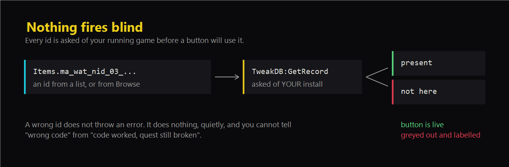
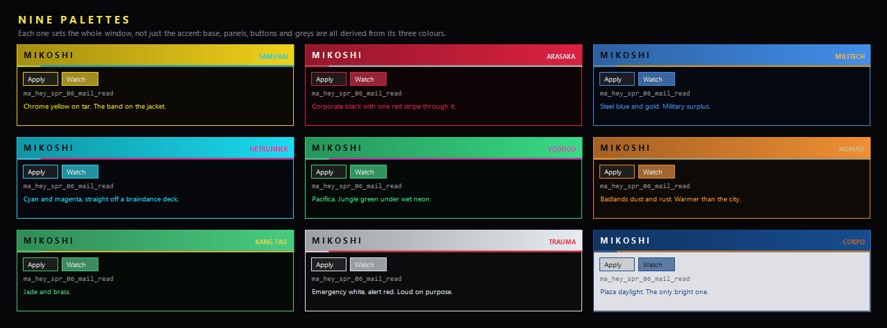

# Mikoshi

A Cyber Engine Tweaks mod menu for Cyberpunk 2077, built for game **2.5** and
**CET 1.38.1**. It repairs stuck quests, hands over items, and browses every
record the running game will admit to.

Folder name is `fixer` and the display name is Mikoshi. The folder stays as it is
so an existing hotkey binding survives a rename.


## Download

[**Mikoshi-1.0.zip**](dist/Mikoshi-1.0.zip) — 27 KB, unzips straight into your
Cyberpunk 2077 folder.

Requires [Cyber Engine Tweaks](https://www.nexusmods.com/cyberpunk2077/mods/107)
1.38.1 or later, on game 2.5.

## Install

**Cyber Engine Tweaks is required.** Mikoshi is a Lua script CET loads and runs,
not a standalone program. Without it nothing appears in game and there is no key
to bind, because the binding does not exist until CET creates it. CET is not
bundled here: it is version-locked to the game patch, so a bundled copy would go
stale and could overwrite a working install with an older one.


Copy `fixer/` to:

```
<Cyberpunk 2077>\bin\x64\plugins\cyber_engine_tweaks\mods\fixer\
```

Open the CET overlay, press **Reload All Mods**. No restart. To remove it,
delete the folder; it writes nothing outside its own directory except a one-line
`theme.txt` beside itself.

To bind a key: overlay, **Bindings**, "Mikoshi: pin the watch card". CET does not let a mod
ship a default key, so it starts unbound.

## The rule this is built on



Nothing fires blind.

Every item id is checked against the live TweakDB when the mod loads, and
anything the game does not recognise is greyed out rather than fired into
nothing. Functions cannot be checked that way, so they are probed against the
`Game` object instead. Where neither is possible, the UI says "could not
verify" instead of implying success.

This is not pedantry. The community id lists were wrong **four separate times**
during one evening of building this:

| Claimed | Actually |
| --- | --- |
| `Items.ma_wat_lch_06_onscreen_01` was "Where the Bodies Hit the Floor" | It is Ticket to the Major Leagues. Different quest, different district. |
| Six Feet Under was `ma_wbr_hil_01` | It is `ma_wat_nid_22` |
| Bloody Ritual was `ma_wat_nid_01` | It is `ma_wat_nid_15` |
| Ammo was `Items.HandgunAmmo` | It is `Ammo.HandgunAmmo` |

A wrong id does not throw. It does nothing, quietly, which is the worst possible
behaviour in a tool whose job is to tell you whether a fix worked.

## Categories

- **Quest Fixes** — fact repairs with read-before-write, templates for fixer
  tier and gig counters, and a checklist of all 17 cyberpsycho sightings with
  their districts and quest ids.
- **Shards** — conversation shards that fail to spawn on a body.
- **Inventory** — eddies, points, ammo, consumables, crafting, iconics.
- **World** — time, weather, teleport, level, attributes.
- **Browse** — reads clothing, weapons and vehicles out of the running game
  (2074 / 1828 / 1379 records here), with search, readable names, quality
  colours and a filter for what V can actually obtain.
- **Diagnostics** — what this build exposes, the palette picker, manual record
  and fact checks.
- **Undo** — every fact write with its previous value.



## What is deliberately not here

- **Setting the weather.** Dumping `Game.GetWeatherSystem()` on 2.5 returns a
  `worldWeatherScriptInterface` whose entire method list reads: rain intensity,
  moisture, puddles, intensity type, and listener registration. There is no
  `SetWeather` on it, and no spelling of a weather name fixes a method that is
  not there. The World tab shows the four rain values it does expose instead.

- **Setting an attribute directly.** It moved the number and nothing else:
  the attribute read 20 afterwards and every perk that attribute gates stayed
  locked, because the number is a stat and the unlocking is done by the
  development system, which the call never tells. A command that looks like it
  worked and did not is the one thing this menu exists to avoid. Attribute
  points remain, because they go through the development system and unlock what
  they are supposed to. The readout stays.

- **Force-completing a quest.** It wrote a journal state with no previous value
  to restore, and on 2.5 the enum names did not resolve, so it fell back to
  hard-coded numbers. A wrong number there is a permanently wrong quest.
- **Story facts.** Johnny's relationship level, Skippy's mode, the Takemura
  flag. Undoing the fact does not undo what the story already did.
- **Teleport without a way back.** The known destinations stay disabled until a
  waypoint exists, because several cannot be left on foot.

Player benefits are all intact. The line is "can it break a run", not "does it
help the player".

## Five traps, paid for

1. **`_G['Name']` does not see CET's globals.** Checking `ImGuiCol` that way
   returned false and silently skipped the entire colour theme, which is why the
   window stayed ImGui default blue while the drawn banner worked. Compile
   `load('return Name')` instead.
2. **`pcall` succeeding is not the call succeeding.** `EnablePlayerVehicle`
   returns a bool and `SpawnPlayerVehicle` returns nothing. Reporting pcall's
   result printed "spawned" for a car that never existed. Treat nil as *no
   confirmation*, not success.
3. **`ImGui.InputInt` draws its own + and -.** Adding a pair next to it gives
   every row two.
4. **`require('IconGlyphs')` fails.** The file is `IconGlyphs/icons.lua`, so
   that path resolves to nothing and the icons silently never load.
5. **A clean Lua parse is not a working file.** `tabWorld` called helpers
   defined below it, which Lua resolves as globals at call time and finds nil.
   Check declaration order separately from syntax.

## Repo contents

- `fixer/` — the mod. `init.lua` is the only file CET loads; `data.lua` is the
  catalog and is the file to edit when adding a fix.
- `probe/` — a throwaway read-only mod that reports what an install exposes.
- `preview.html` — a command reference, readable on a phone while playing. The
  styling is not what the overlay looks like; the commands are accurate.
- `HANDOFF.md` — the original brief, written before any of this existed.

## Licence

MIT. Do what you like with it, including shipping your own version, as long as
the copyright notice travels with it. Mods that only use the Cyber Engine
Tweaks scripting API are not bound by CET's own GPL.
